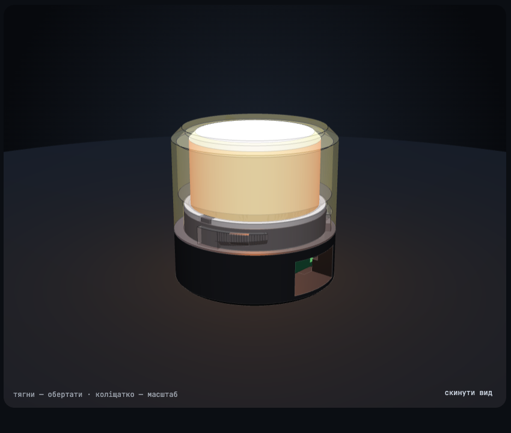
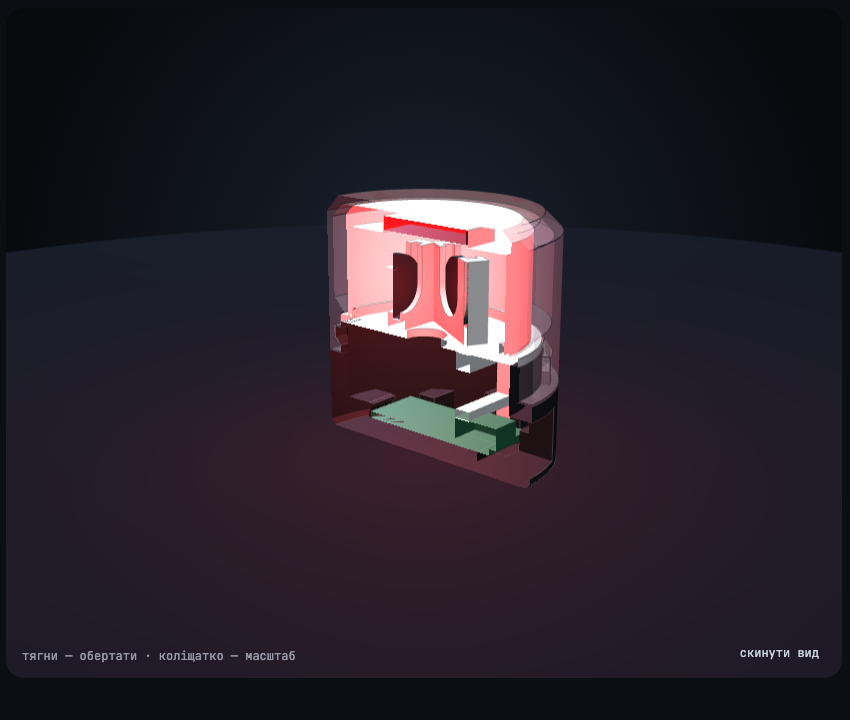

# Корпус

Ø38 × 36,1 мм, п'ять деталей, друк без підтримок і без AMS. Модель параметрична, на Python (manifold3d + trimesh): усі розміри й зазори — у `case/build.py`.

| У зборі | Розріз |
|---|---|
|  |  |

Покрутити, розібрати і приміряти кольори: `case/preview/index.html` (або `python3 web/serve.py` і «Корпус у 3D»).

## Деталі

| Деталь | Файл | Філамент | На столі, мм | Як лежить | Навіщо |
|---|---|---|---|---|---|
| основа | `base.stl` | чорний | 35,8 × 38 × 18 | дном донизу | тримає плату; спереду пласка грань з вікном точно під роз'єм USB-C; шийка з байонетом |
| засувка | `clamp.stl` | білий | 15,3 × 22 × 3,4 | плазом, виступом догори | не дає платі відсунутись назад і піднятись |
| диск із кишенями | `carrier.stl` | білий | 33 × 32,8 × 12,9 | диском донизу | три кишені під платки діодів, колодязь Ø8 для дротів, бортик із канавкою защіпки |
| розсіювач | `diffuser.stl` | білий | 30 × 30 × 16,8 | догори дном | розмиває світло і ховає нутрощі; у стелі гніздо під сенсор; засклацується на диск |
| ковпак | `dome.stl` | прозорий | 38 × 38 × 23,8 | догори дном | зовнішня оболонка, замикається поворотом |

## Файли до друку

Усе лежить у `case/stl/`, деталі вже в положенні для друку.

| Плита | Що в ній | Філамент |
|---|---|---|
| `plate_black.3mf` | основа | чорний |
| `plate_white.3mf` | диск із кишенями, розсіювач, засувка | білий |
| `plate_clear.3mf` | ковпак | прозорий |

Поруч ті самі деталі окремими STL — для іншого розкладу кольорів — і пробник вікна під роз'єм `usb_fit_test.stl` (див. нижче). Деталі у 3MF лежать від кута координат; якщо слайсер не відцентрує їх сам, натисни «Arrange».

## Налаштування слайсера

- Шар 0,2 мм, сопло 0,4 мм.
- Без підтримок. Єдині нависання — спереду основи: стеля кишені під плату (міст 18 мм) і верх вікна USB.
- Компенсацію «слонячої ноги» лиши ввімкненою: на неї розраховані посадки засувки й диска.
- Для ковпака й розсіювача шов постав «ззаду» або «вирівняний».
- Крізь прозорий низ ковпака видно шийку основи із зубами. Щоб сховати — заміна філаменту на висоті 15,5 мм дасть непрозорий поясок.

## Як воно тримається

- **Ковпак** надягається на шийку основи: три зуби заходять у вертикальні пази, далі поворот за годинниковою. Полиця паза плавно піднімається і затягує ковпак донизу приблизно на 25° з 35° ходу.
- **Розсіювач** засклацується на бортик диска: три виступи всередині нього заходять у канавку по колу бортика. Тому диск із діодами, сенсором і розсіювачем тримається купи сам, і ковпак закручується, нічого не притримуючи. Знімається розсіювач рукою: схили защіпки — 45°.
- Крім того, розсіювач на 0,1 мм вищий за місце під ковпаком, тож закручений ковпак притискає його до диска — він не бовтається.
- **Місце під дроти:** колодязь у центрі диска Ø8 мм, трикутний, з кутами на 8,8 мм від осі; під сенсором до верху кишень 2,9 мм. Повертай розсіювач так, щоб край сенсора з контактами став над кутом колодязя, між двома кишенями: тоді дроти йдуть прямо вниз.
- **Плата** лежить на ребрі між рядами пінів. Передній край заходить у кишеню в стінці, а роз'єм USB — у вікно на пласкій грані, з зазором 0,1 мм: штекер упирається в грань, і нічого не хитається. Уперед плату не пускає стінка, назад — засувка; її виступ лежить на задньому краї плати, а саму засувку зверху тримає диск.
- **Кишеня в стінці** має 2 мм над платою й 1,5 мм під нею — для припою й дротів на перших пінах.
- **Сенсор** сидить у гнізді товстої (3,2 мм) стелі розсіювача. Крізь неї модуль не видно, а до пальця лишається 2,0 мм пластику: 0,8 білого і 1,2 прозорого.

## Зазори

| Де | Зазор, мм |
|---|---|
| шийка основи в спідниці ковпака | 0,20 на радіус |
| зуб у пазу ковпака | 0,30 |
| диск у ковпаку | 0,30 на радіус |
| плата в гнізді | 0,20 з боків |
| платка діода в кишені | 0,20 на радіус, паз 1,5 мм |
| роз'єм USB у вікні | 0,10 з боку |
| засувка в пазу | 0,20 з боку |
| засувка до диска | 0,15 |
| плата між стінкою й засувкою | 0,10 + 0,10 |
| сенсор у гнізді (15,5 × 11,5 × 2,4 мм) | 0,25 з боку |
| розсіювач на бортику диска | 0,10 на радіус; три виступи защіпки заходять на 0,2 мм, поки не клацнуть |
| розсіювач під ковпаком | −0,10 (натяг) |

Найтонші елементи: стінка розсіювача й шар над сенсором 0,8 мм, губи кишень 0,9 мм, стінка ковпака в пазах 1,0 мм.

## Перебудувати і перевірити

```sh
python3 -m venv .venv && .venv/bin/pip install -r case/requirements.txt
.venv/bin/python case/build.py            # STL і 3MF у case/stl/
.venv/bin/python case/verify.py           # перевірка, код виходу 1 при проблемах
.venv/bin/python case/export_preview.py   # оновити моделі на сторінці превью
```

`verify.py` перевіряє: сітки замкнені й кожна деталь — одне тіло; деталі стоять на столі й не мають нависань понад 45° (крім мостів спереду основи); у складеному стані нічого не перетинається, крім двох задуманих натягів; кожна деталь доходить до місця без зачіпань; ковпак після повороту не знімається і затягує навіть при відхиленні висоти на ±0,2 мм.

Корпус попередньої версії надрукований на Bambu A1 mini і зібраний: деталі сидять добре, розсіювач під ковпаком не бовтається. Нова версія ще не друкувалась: роз'єм USB у щільному вікні, засувка замість рамки, ширший колодязь під дроти й защіпка розсіювача. Ковпак лишився той самий — байт у байт, передруковувати його не треба.

Чого перевірка не бачить: реальну точність принтера і розміри твоїх деталей. Перед друком звір штангенциркулем три розміри, взяті як типові:

| Параметр у `build.py` | Значення | Що це |
|---|---|---|
| `PCB_T` | 1,0 мм | товщина плати ESP |
| `LED_PCB_T` | 1,2 мм | товщина платки діода без самого діода |
| `TOUCH_L`, `TOUCH_W`, `TOUCH_T` | 15 × 11 × 2 мм | модуль TTP223 з деталями |

### Вікно під роз'єм USB

Посадка роз'єму щільна, тому перед друком основи варто звірити розміри плати й надрукувати пробник.

| Параметр у `build.py` | Значення | Що це |
|---|---|---|
| `USB_W`, `USB_H` | 8,94 × 3,26 мм | корпус роз'єму USB-C |
| `USB_OVERHANG` | 1,2 мм | на скільки роз'єм виступає за край плати |
| `PCB_T` | 1,0 мм | товщина плати: від неї залежить висота вікна |

`usb_fit_test.stl` — шматок передньої стінки з п'ятьма вікнами: зазор 0; 0,05; 0,10; 0,15; 0,20 мм, кількість рисок згори — номер вікна. Друкується стоячи, за 10 хвилин. Встав роз'єм плати в кожне вікно: потрібне те, де він заходить рукою без зусилля, але не хитається. Його зазор вписується в `USB_FIT` (зараз 0,10).

Якщо замок ковпака вийде тугим або вільним — це `FIT`; якщо розсіювач бовтається або не дає докрутити ковпак — `DIFF_PRELOAD`.

Тексти й таблиці на сторінці превью після зміни моделі треба оновити вручну: `export_preview.py` міняє лише 3D-моделі.
